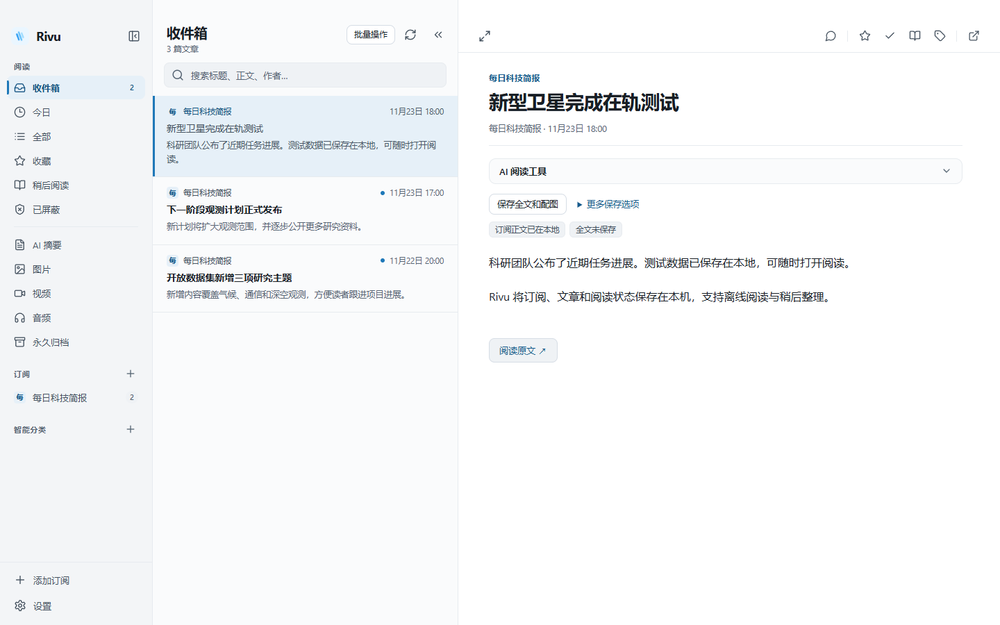
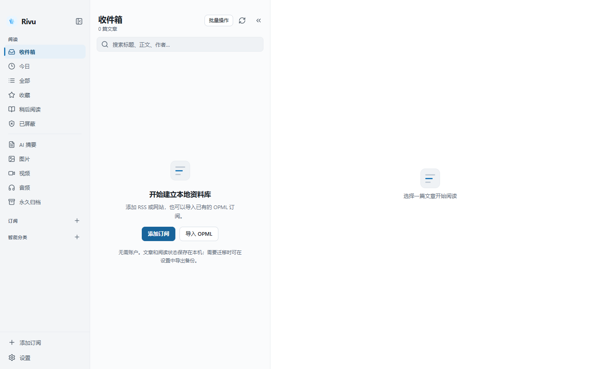

# Rivu

[English](README_EN.md)

Rivu 是一款面向 Windows 的本地优先 RSS 阅读器。订阅、文章和阅读状态默认保存在本机，核心阅读不需要账户。



*截图使用本地合成的演示订阅与文章，不含个人资料。*



## 下载

[下载 Windows x64 便携版](https://github.com/rowanjove/Rivu/releases/latest/download/Rivu-0.1.0-portable-win-x64.zip) · [SHA-256 校验值](https://github.com/rowanjove/Rivu/releases/latest/download/SHA256SUMS.txt) · [查看所有版本](https://github.com/rowanjove/Rivu/releases)

解压完整 ZIP 后运行目录中的 `Rivu.exe`。这是便携目录包，不是单文件 EXE 或安装程序；请保留解压目录中的其他文件。

当前发布包尚未进行代码签名。运行前可先对照 Release 中的 SHA-256 校验值。

## 功能

- 订阅 RSS、Atom、JSON Feed 和公开 JSON API；支持 OPML 导入与导出。
- 在时间线中搜索、分类、收藏和管理已读状态，支持本地全文搜索与智能文件夹。
- 将文章与配图保存到本机离线阅读，或创建可独立导出的永久归档。
- 备份和恢复本地资料库；备份默认不包含 AI 密钥。
- 可选配置 OpenAI Compatible 服务，用于摘要、翻译、问答和分类建议。手动请求会先展示发送范围并由用户确认；自动规则需单独授权。
- 读取本地 `.eml` Newsletter，查看文章中的图片、音频和视频链接。

## 数据与隐私

应用不要求账户。数据库、设置和日志保存在 `%APPDATA%\rivu`，本地 API 仅绑定 `127.0.0.1`。未配置 AI 时不会调用 AI 服务；启用后，文章内容只会按你确认的请求发送给所配置的 Provider。授权自动规则后，后续匹配文章可能自动发送给该 Provider。

应用不会随订阅内容提供云同步。备份默认排除 API 密钥；只有主动勾选后才会把密钥写入备份文件。

## 从源码运行

开发和构建需要 Node.js 24、npm；生成 Windows 发布包需要 Windows。

```powershell
npm ci
npm run dev
```

运行测试并构建便携目录包：

```powershell
npm test
npm run dist:win
```

`npm run dist:win` 会执行类型检查、构建、ZIP 校验和一次打包桌面主流程验证。完整测试也可单独运行 `npm test`。

## 许可证

Rivu 采用 [Apache License 2.0](LICENSE)。第三方依赖保留其各自许可证；清单见 [THIRD-PARTY-NOTICES.md](THIRD-PARTY-NOTICES.md)，完整许可证文本见 [THIRD-PARTY-LICENSES.txt](THIRD-PARTY-LICENSES.txt)。
