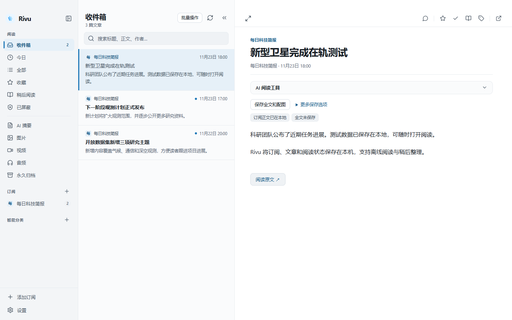
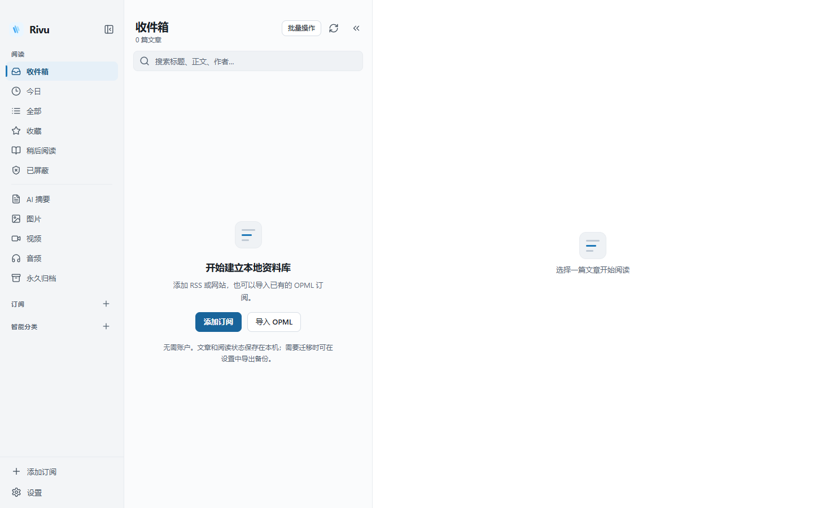

<div align="center">


# Rivu

**A local-first desktop RSS reader for Windows**

Your feeds, articles, offline assets, and reading state stay on your device by default — no account required and no cloud lock-in.

[](https://github.com/rowanjove/Rivu/releases)
[](https://github.com/rowanjove/Rivu/releases)
[](package.json)
[](LICENSE)

[简体中文](README.md) · [Download](#download) · [Features](#features) · [Data & Privacy](#data-and-privacy) · [Run from Source](#run-from-source) · [License](#license)

</div>

---



> *The screenshots use synthetic local data and contain no personal information. The current app interface is in Simplified Chinese.*

<details>
<summary>View first-launch empty library screenshot</summary>



</details>

## Download

- **[Download the portable Windows x64 build (v0.1.0)](https://github.com/rowanjove/Rivu/releases/latest/download/Rivu-0.1.0-portable-win-x64.zip)**
- **[SHA-256 checksum](https://github.com/rowanjove/Rivu/releases/latest/download/SHA256SUMS.txt)** · **[All releases](https://github.com/rowanjove/Rivu/releases)**

### Notes

1. Extract the full ZIP archive and run `Rivu.exe` from the extracted directory. This is a **portable app directory** (not a single-file executable or installer); keep the surrounding files alongside the executable.
2. The current release is **not code-signed**. Verify its SHA-256 checksum against `SHA256SUMS.txt` in PowerShell before running it:
   ```powershell
   Get-FileHash .\Rivu-0.1.0-portable-win-x64.zip -Algorithm SHA256
   ```
3. Data is stored under `%APPDATA%\rivu` by default. You can point Rivu to an isolated directory by setting the `RIVU_DATA_DIR` environment variable.

## Features

### Flexible Sources & Import
- **Feeds & custom sources**: Subscribe to RSS, Atom, JSON Feed, public JSON APIs with custom field-path mapping, and self-hosted or public RSSHub instances.
- **Local newsletters**: Read `.eml` newsletters directly from a local folder.
- **Easy migration**: Preview and import/export OPML files, and view image, audio, and video media links in articles.

### Focused Reading & Organization
- **Customizable reading**: Three-pane workspace with immersive reading mode; light, dark, and system themes; adjustable font family, size, line height, column width, and UI density.
- **Full-text & search**: Built-in article extraction via Mozilla Readability and fast local full-text search.
- **Rules & organization**: Categories, tags, bookmarks, smart folders, and priority-based local rules (automatically tag, save, mute, or block entries by feed, keywords, date, or tag).
- **Keyboard shortcuts**:

| Shortcut | Action |
| --- | --- |
| `J` / `K` | Next / previous entry |
| `S` | Star / unstar |
| `M` | Toggle read / unread |
| `O` | Open original link in browser |
| `Esc` | Exit immersive reading |

### Offline Reading & Permanent Archives
- **Offline saves**: Cache article bodies and images locally for offline reading.
- **Permanent archives**: Create versioned local archives with optional images, audio/video attachments, and source webpage snapshots, and export them as self-contained ZIP archives (`index.html`, `metadata.json`, and bundled assets).

### Optional, Transparent AI Assistance
- **OpenAI-compatible providers**: Works with local model servers (defaulting to `http://127.0.0.1:1234/v1`) or remote OpenAI-compatible APIs, with per-task model selection.
- **Reading workflows**: Summaries, full-article translation (side-by-side or translation-only), citation-backed Q&A, keywords, classification, explanations, rewrites, tag suggestions, and filter review.
- **Explicit consent**: Manual AI requests preview what will be sent and require confirmation first. Automatic AI rules (summary / keywords / classification) require separate authorization and enforce per-batch item limits.

### Local Backups & Network Control
- **Manual & scheduled backups**: Create verified backups and restore safely with journaled recovery; optionally enable daily or weekly automatic backups (retaining the latest 7 archives).
- **Proxy settings**: Follow environment variables, connect directly, or configure custom HTTP/HTTPS proxies and bypass lists.

## Data and Privacy

- **No account, no cloud sync**: Rivu does not require sign-in and does not sync your subscriptions to any cloud service.
- **Local storage & loopback-only API**: The SQLite database, settings, and logs live under `%APPDATA%\rivu`, and the local API binds exclusively to `127.0.0.1`.
- **Opt-in AI only**: Rivu makes zero AI network calls until you configure a provider. Manual actions send content only after you confirm the previewed scope; authorized automatic rules may send subsequent matching entries to your configured provider.
- **Secret exclusion by default**: Backups omit AI API keys unless you explicitly opt in to include them.

## Tech Stack

- **Desktop & UI**: Electron · React 19 · TypeScript · Vite
- **Local service & storage**: Fastify · Node.js 24 (`node:sqlite`) · Mozilla Readability · DOMPurify

## Run from Source

Development and builds require **Node.js 24** and **npm**. Building the Windows portable package requires **Windows**.

```powershell
# Install dependencies
npm ci

# Start in development mode (Vite + Electron)
npm run dev
```

Common scripts:

| Command | Description |
| --- | --- |
| `npm test` | Build server modules and run the full test suite |
| `npm run dist:win` | Type-check, build, package the Windows portable ZIP, verify contents, and run the desktop smoke flow |
| `npm run release:verify` | Run full regression tests, verify the latest packaged build, and clean up old build artifacts |

## License

Rivu is licensed under the [Apache License 2.0](LICENSE); see [NOTICE.md](NOTICE.md) for attribution details.

Third-party dependencies remain under their respective licenses: see [THIRD-PARTY-NOTICES.md](THIRD-PARTY-NOTICES.md) and the full [third-party license texts](THIRD-PARTY-LICENSES.txt).
